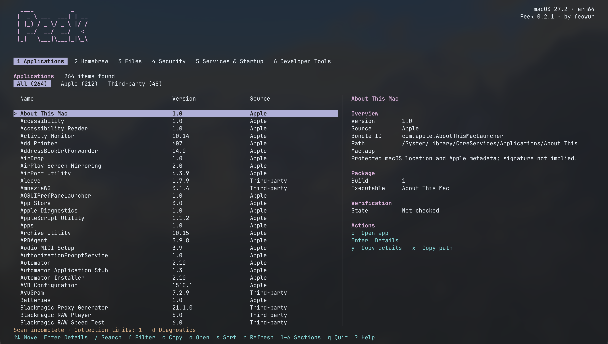

# Peek

*take a look around.*

Peek is my personal experiment in how far I can take a macOS terminal inspector while keeping one promise: **inspection stays read-only.**

It started as a small way to look around my own Mac and gradually grew into something more. I wanted to see how useful, detailed, and polished a terminal tool could become without turning it into another system optimizer, cleaner, or security fixer.

Peek lets you explore the apps, files, services, developer tools, and security settings already on your Mac. It observes and explains things without silently changing the system.

Actions like opening an app, revealing a file in Finder, or copying information are explicit and separate from inspection. Uninstalling Peek is also an intentional, confirmed action.

Mostly just looking around.



## what it does

Peek is a colorful, keyboard-driven macOS terminal interface for exploring what's already on your machine.

It has six sections:

- **Applications** — Browse installed apps, versions, locations, and available metadata.
- **Homebrew** — Inspect locally installed formulae, casks, and taps.
- **Files** — Find filenames in common user folders or a chosen directory, without Spotlight.
- **Security** — Inspect six macOS security controls and view management-command references without executing them.
- **Services & Startup** — Explore launch agents, daemons, and their available state information.
- **Developer Tools** — Discover locally available development tools, environments, and app-bundle details.

Peek doesn't clean your Mac, change security settings, uninstall discovered apps, or run system optimizations.

File search is deliberately bounded, so it doesn't pretend to inventory your entire disk. Some system information may also be unavailable due to macOS permissions or other limitations.

## installation

Requires macOS and Python 3.11 or newer.

**Current published release: v0.2.0**

```sh
(
  set -e
  tmp="$(mktemp -d)"
  trap 'rm -rf "$tmp"' EXIT

  curl -fsSL \
    https://github.com/feowur/Peek/releases/download/v0.2.0/peek-0.2.0-bootstrap.py \
    -o "$tmp/peek-bootstrap.py"

  printf '%s  %s\n' \
    'fc1d7ddf52643a963b33144f35d79ae7b2c39a355217ca93944af8a8f3d67380' \
    "$tmp/peek-bootstrap.py" | shasum -a 256 -c -

  python3 "$tmp/peek-bootstrap.py" \
    --url https://github.com/feowur/Peek/releases/download/v0.2.0/peek-0.2.0-install.zip \
    --sha256 2bc7bbd5f65cf6245045cb61a2d4ba75785f17e8845b2a910ccb4e212db805e4
)
```

Once installed, run:

```sh
peek
```

Press `?` inside Peek for the controls reference.

## uninstall

To remove an installed copy of Peek:

```sh
peek gtfo
```

Peek shows the verified installation targets and asks for confirmation before removing its own installation.

It does not remove your personal files or change your shell configuration.

## run from source

Peek v0.2.0 is now available on GitHub. You can also run it directly from a source checkout.

To run v0.2.0 directly from a source checkout:

```sh
cd ~/Projects/Peekcli
PYTHONPATH=src .venv/bin/python -m peekcli
```

Peek v0.2.0 includes six sections, native filename search without Spotlight, a compact one-screen Help reference, and display-only management instructions for the six Security controls.

Files supports inspection, Finder reveal, and copying, but never launches selected files.

Peek is English-only and does not include a Settings menu.

### local build

From a source checkout with the necessary build tools:

```sh
python3 scripts/build_bundle.py
```

Local candidate artifacts and checksums are written to:

```text
dist/0.2.0/
```

To install a reviewed wheel, provide its independently verified SHA-256 checksum:

```sh
python3 scripts/install.py \
  --wheel dist/0.2.0/peekcli-0.2.0-py3-none-any.whl \
  --sha256 TRUSTED_WHEEL_SHA256
```

Peek does not overwrite an existing installation or automatically update itself. A manual upgrade requires explicitly uninstalling the previous copy before installing the new version.

For further information about commands, search limits, security boundaries, and installation, see the [usage guide](docs/USAGE.md).

---

made by feowur.
